# Lab Report: TryHackMe Rooms

**Room 1:** Phishing Analysis Fundamentals (SOC Level 1 Path, Phishing Analysis module)
**Room 2:** Windows Forensics 1 (Introduction to Windows Registry Forensics)

| | |
|---|---|
| **Name** | |
| **Student ID** | |
| **Programme** | BE Software Engineering, College of Science and Technology |
| **Date** | 22 October 2026 |

---

## Contents

- [Part A: Phishing Analysis Fundamentals](#part-a-phishing-analysis-fundamentals)
- [Part B: Windows Forensics 1](#part-b-windows-forensics-1)
- [Overall Conclusion](#overall-conclusion)

---

# Part A: Phishing Analysis Fundamentals

## A1. Objective

The aim of this lab was to learn how emails are structured and delivered, and how to use that knowledge to analyse a suspicious email. The room covered email addresses, the protocols used to send and receive mail, email headers, the email body and attachments, and common types of phishing. At the end I analysed a real phishing sample to find the spoofed brand, the real sender and the originating IP.

## A2. Tools and Environment

- TryHackMe room "Phishing Analysis Fundamentals" (room code phishingemails1tryoe)
- TryHackMe Ubuntu VM in split screen mode, with the sample emails in the Email Samples folder on the desktop
- Linux terminal tools: grep, sed, base64, file, pdftotext

## A3. Procedure and Findings

### Task 1: Introduction

I read the introduction and started the VM. The sample files used in the room are email1.eml, email2.txt and email3.eml.

### Task 2: The Email Address

An email address has three parts: the username, the @ symbol and the domain. The domain tells the mail system which server should receive the message. For the address hatsalesman@tryhatme.com the domain is tryhatme.com. This is a good example of a look alike domain, since it is one letter away from tryhackme.com.

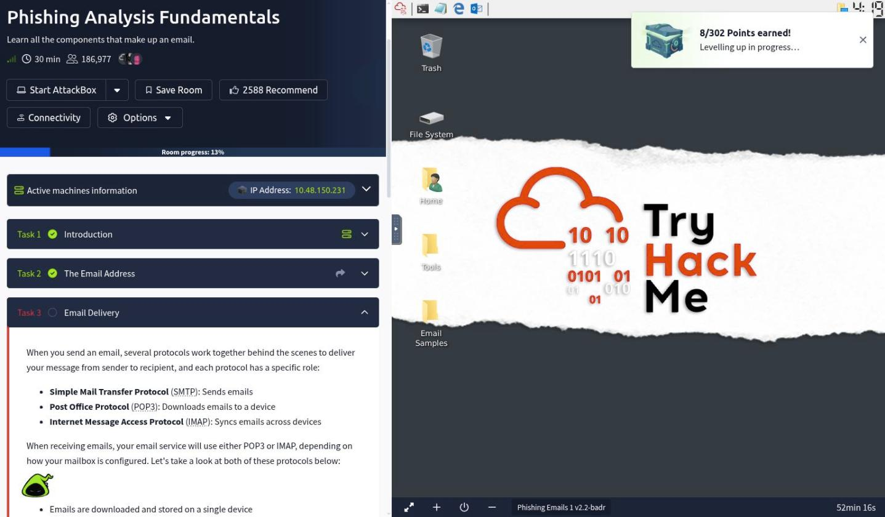
*Figure 1: Task 2 completed after submitting the domain*

### Task 3: Email Delivery

SMTP is used to send email from the client to the mail server and between mail servers. DNS is used to find the mail server (MX record) for the recipient domain. For receiving, POP3 downloads mail to one device and usually removes it from the server, while IMAP keeps mail on the server and syncs it across devices. Since Bob wants to read his mail on both his phone and laptop, IMAP is the right choice.

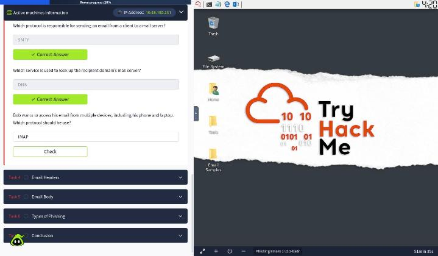
*Figure 2: Task 3 answers: SMTP, DNS and IMAP*

### Task 4: Email Headers

An email is made of a header and a body. The header holds metadata like From, To, Reply-To, Subject and Date, and the raw source also shows fields added by the servers that handled the message. Instead of opening email1.eml in Thunderbird, I pulled the headers straight from the raw file in the terminal:

```
cd ~/Desktop/Email\ Samples
grep -iE '^(Subject|From|X-Originating-IP|Authentication-Results):' email1.eml
```

The subject was "Help protect your budget by protecting your home" and the X-Originating-IP was 43.255.56.161. The From field showed "ADT Security Services" but the actual address was newsletters@ant.anki-tech.com, so the display name does not match the sending domain.

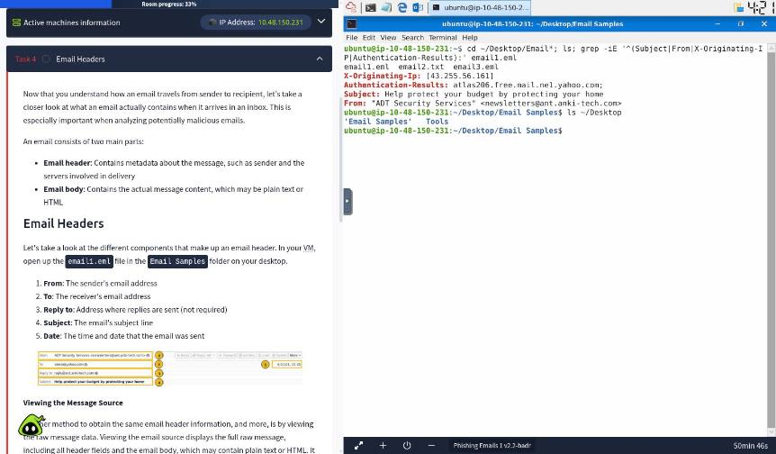
*Figure 3: Header fields of email1.eml extracted with grep*

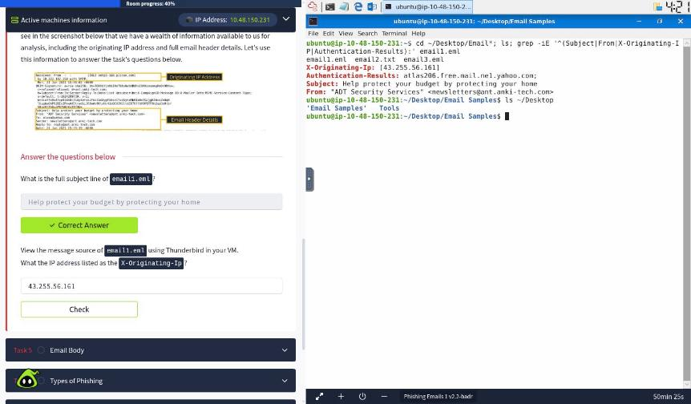
*Figure 4: Task 4 answers submitted*

### Task 5: Email Body

The body can be plain text or HTML, and attachments are stored inside the message as base64 text. In email2.txt the attachment headers showed the type and file name:

```
grep -n -iE 'content-|boundary' email2.txt
```

This gave Content-Type: application/pdf and the file name zmqpalgh.pdf, with Content-Transfer-Encoding: base64. The base64 data sat between line 5 and the closing boundary on line 625, so I decoded those lines back into a PDF and read its text:

```
sed -n '5,624p' email2.txt | base64 -d > /tmp/a.pdf
file /tmp/a.pdf; pdftotext /tmp/a.pdf -
```

The file command confirmed it was a PDF (version 1.6), and the text inside was the flag THM{BENIGN_PDF_ATTACHMENT}. Doing this in a terminal is also safer than opening the attachment in a viewer, since nothing in the file gets executed.

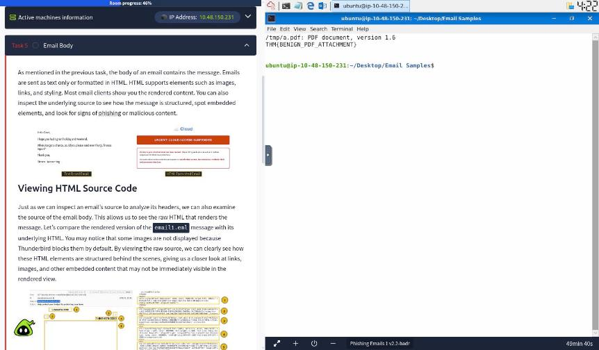
*Figure 5: Attachment decoded from base64 and the flag read from the PDF*

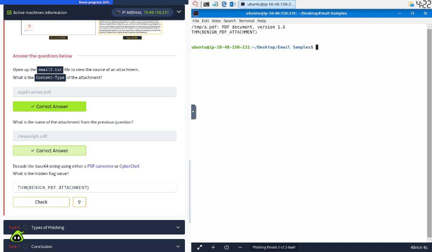
*Figure 6: Task 5 answers submitted*

### Task 6: Types of Phishing

This task covered spam, phishing, spear phishing, whaling, smishing and vishing, plus the common signs of a phishing email such as a spoofed sender, urgent wording, brand impersonation, generic greetings, hidden links and disguised attachments. It also explained defanging, where characters in URLs and IPs are replaced (for example . becomes [.]) so they cannot be clicked by accident.

For the investigation I ran the same header search on email3.eml:

```
grep -iE '^(From|Subject|X-Originating-IP|Authentication-Results|Return-Path|Reply-To):' email3.eml
```

The From display name was MIME encoded (=?UTF-8?B?...?=), which hides it from a quick look. I decoded it with base64:

```
echo VGhhbmsgeW91ISBIb21lIERlcG90 | base64 -d
```

It decoded to "Thank you! Home Depot", so the email pretends to come from Home Depot. The real sender, Return-Path and Reply-To were all support@teckbe.com, which has nothing to do with Home Depot. The X-Originating-IP was 103.234.236.83, which defanged is 103[.]234[.]236[.]83. The Authentication-Results header was added by atlas102.free.mail.gq1.yahoo.com, which is the receiving Yahoo mail server.

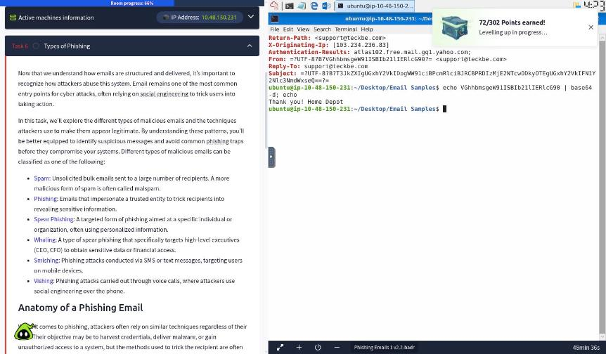
*Figure 7: Headers of email3.eml and the decoded sender name*

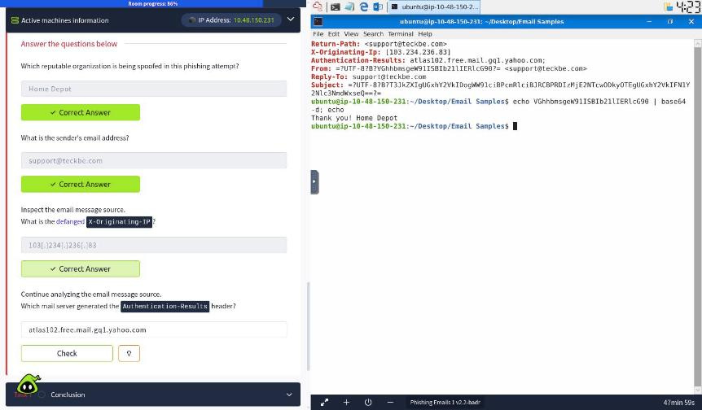
*Figure 8: Task 6 answers submitted*

### Task 7: Conclusion

The last task introduced Business Email Compromise (BEC). In a BEC attack the attacker takes over a real internal email account and uses it to trick other staff into things like paying fake invoices. It is harder to spot than normal phishing because the email really does come from a trusted account.

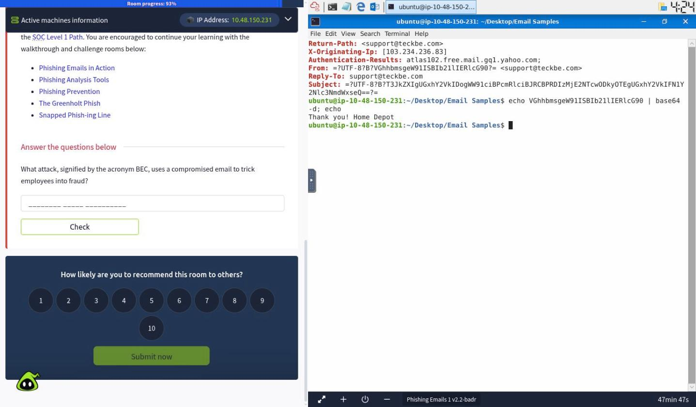
*Figure 9: Task 7 question on BEC*

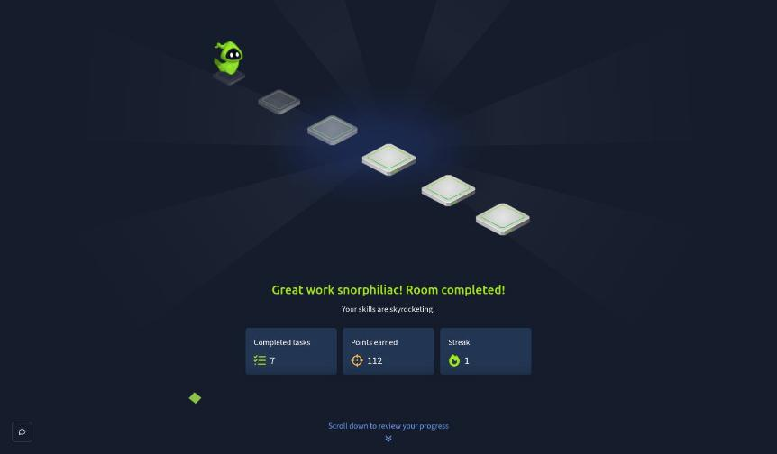
*Figure 10: Room completed with all 7 tasks done and 112 points earned*

## A4. Summary of Answers

| Task | Question | Answer |
|---|---|---|
| 2 | Domain in hatsalesman@tryhatme.com | tryhatme.com |
| 3 | Protocol that sends email from client to server | SMTP |
| 3 | Service used to look up the recipient mail server | DNS |
| 3 | Protocol for accessing mail on multiple devices | IMAP |
| 4 | Full subject line of email1.eml | Help protect your budget by protecting your home |
| 4 | X-Originating-IP of email1.eml | 43.255.56.161 |
| 5 | Content-Type of the attachment in email2.txt | application/pdf |
| 5 | Name of the attachment | zmqpalgh.pdf |
| 5 | Hidden flag in the decoded PDF | THM{BENIGN_PDF_ATTACHMENT} |
| 6 | Organization being spoofed in email3.eml | Home Depot |
| 6 | Sender email address | support@teckbe.com |
| 6 | Defanged X-Originating-IP | 103[.]234[.]236[.]83 |
| 6 | Server that generated Authentication-Results | atlas102.free.mail.gq1.yahoo.com |
| 7 | What does BEC stand for | Business Email Compromise |

## A5. Conclusion

I completed all seven tasks in the room. The main thing I took away is that the display name and the visible content of an email can be faked easily, but the raw headers usually give the attacker away. In email3.eml the sender name was even encoded to hide "Home Depot" from simple filters, while the real address was an unrelated domain. Checking the From address against Return-Path and Reply-To, looking at the originating IP and the Authentication-Results, and decoding attachments in a safe way are simple steps that make it much easier to decide whether an email is malicious.

# Part B: Windows Forensics 1

## B1. Aim

The aim of this lab was to learn how the Windows Registry can be used in a forensic investigation. The room covers where the registry hives are stored, how to collect them, which tools can read them, and which keys give useful evidence about the system, its users, the files they opened, the programs they ran and the USB devices that were plugged in.

## B2. Tools Used

- TryHackMe Windows Forensics 1 room and its attached Windows VM
- Eric Zimmerman's Registry Explorer (v1.6.0.0) from the EZtools folder on the VM
- Triage data collected with KAPE, stored in the triage folder on the VM desktop

## B3. Theory Summary

### Windows Registry

The registry is a database that stores configuration data for the hardware, software and users of a Windows machine. It is made of keys and values, and a group of keys stored in one file is called a hive. There are five root keys: HKEY_CURRENT_USER, HKEY_USERS, HKEY_LOCAL_MACHINE (HKLM), HKEY_CLASSES_ROOT and HKEY_CURRENT_CONFIG.

### Hive Locations

The main hives DEFAULT, SAM, SECURITY, SOFTWARE and SYSTEM are stored in C:\Windows\System32\Config. Each user also has NTUSER.DAT in their profile folder and USRCLASS.DAT under AppData\Local\Microsoft\Windows. The AmCache hive is at C:\Windows\AppCompat\Programs\Amcache.hve. Transaction logs (.LOG1, .LOG2) hold changes that may not be written to the hive yet, and the RegBack folder keeps backups of the hives.

### Data Acquisition and Tools

The hive files are locked on a live system so they cannot just be copied. Tools like KAPE, Autopsy and FTK Imager are used to collect them. To read them, the room introduced AccessData Registry Viewer, Registry Explorer and RegRipper. Registry Explorer was used in this lab because it can load several hives at once, merge the transaction logs and has bookmarks for the important forensic keys.

### Important Forensic Keys

- **System info:** OS version in SOFTWARE\Microsoft\Windows NT\CurrentVersion, computer name, time zone, network interfaces and the current control set from SYSTEM\Select.
- **User accounts:** SAM\Domains\Account\Users holds RID, login count, last login and password hints.
- **Files and folders:** RecentDocs, Office MRU, ShellBags, Open/Save and LastVisited MRU, TypedPaths and WordWheelQuery in NTUSER.DAT and USRCLASS.DAT.
- **Evidence of execution:** UserAssist (NTUSER.DAT), ShimCache/AppCompatCache (SYSTEM), AmCache (stores SHA1 hashes) and BAM/DAM (stores full path and last run time).
- **USB devices:** SYSTEM\CurrentControlSet\Enum\USBSTOR and Enum\USB, plus SOFTWARE\Microsoft\Windows Portable Devices\Devices for the friendly name.

## B4. Room Questions and Answers (Tasks 1 to 9)

Tasks 1 to 9 were answered from the room notes and the Registry Explorer screenshots given in each task. The table below lists the answers and the screenshots after it show each task marked as correct.

| Task | Question | Answer |
|---|---|---|
| 1 | Most used Desktop Operating System right now? | Microsoft Windows |
| 2 | Short form for HKEY_LOCAL_MACHINE? | HKLM |
| 3 | Path of the five main hives? | C:\Windows\System32\Config |
| 3 | Path of the AmCache hive? | C:\Windows\AppCompat\Programs\Amcache.hve |
| 4, 5 | Reading tasks | No answer needed |
| 6 | Current Build Number? | 19044 |
| 6 | ControlSet with last known good config? | 1 |
| 6 | Computer Name? | THM-4n6 |
| 6 | TimeZoneKeyName? | Pakistan Standard Time |
| 6 | DHCP IP address? | 192.168.100.58 |
| 6 | RID of the Guest account? | 501 |
| 7 | When was EZtools opened? | 2021-12-01 13:00:34 |
| 7 | When was My Computer last interacted with? | 2021-12-01 13:06:47 |
| 7 | Absolute path of file opened with notepad.exe? | C:\Program Files\Amazon\Ec2ConfigService\Settings |
| 7 | When was this file opened? | 2021-11-30 10:56:19 |
| 8 | How many times was File Explorer launched? | 26 |
| 8 | Another name for ShimCache? | AppCompatCache |
| 8 | Artifact that also saves SHA1 hashes? | AmCache |
| 8 | Artifact that saves full path of executed programs? | BAM/DAM |
| 9 | Serial number of the Kingston device? | 1C6f654E59A3B0C179D366AE&0 |
| 9 | Name of this device? | Kingston Data Traveler 2.0 USB Device |
| 9 | Friendly name of the Kingston device? | USB |

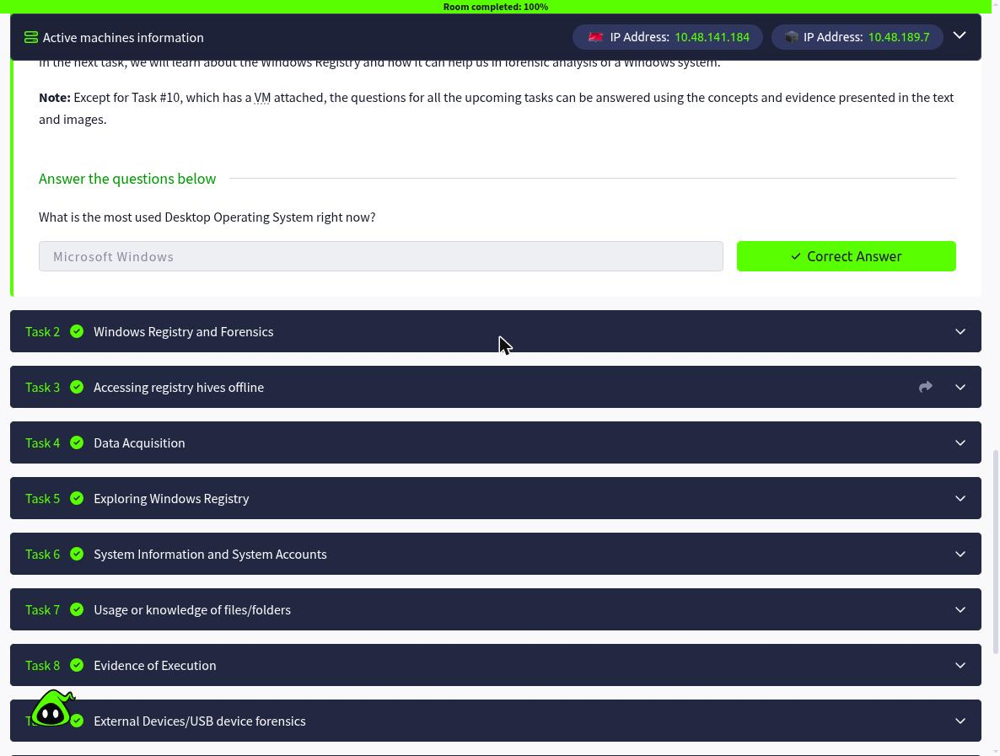
*Figure 11: Task 1 answered correctly*

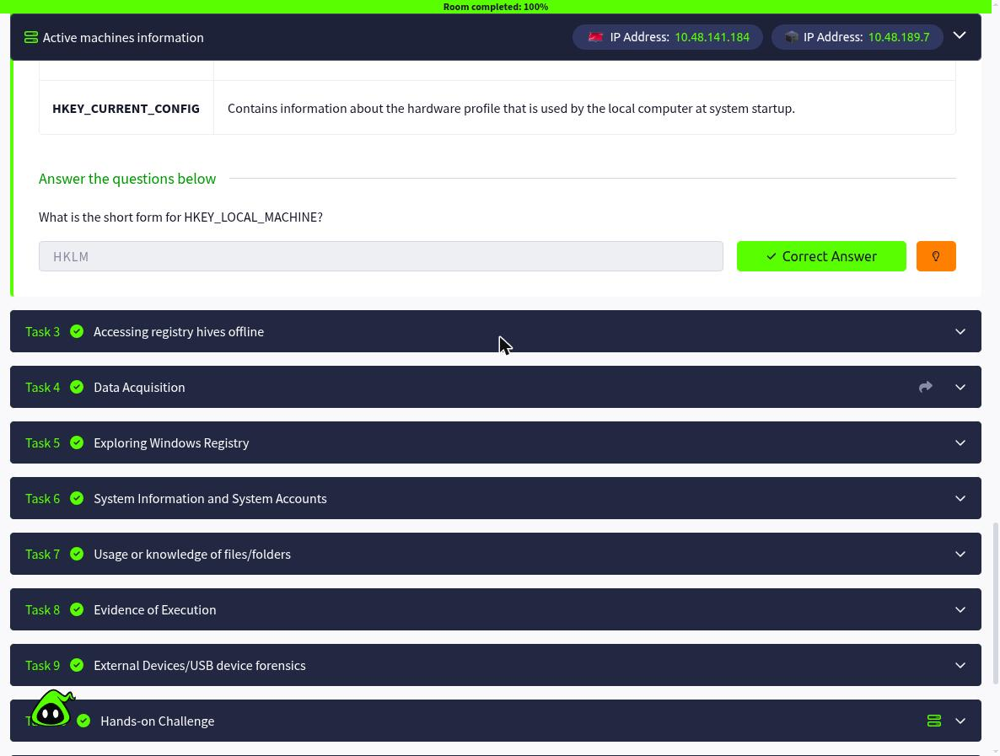
*Figure 12: Task 2 answered correctly*

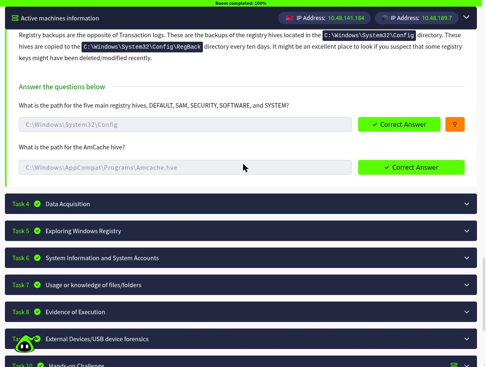
*Figure 13: Task 3 answered correctly*

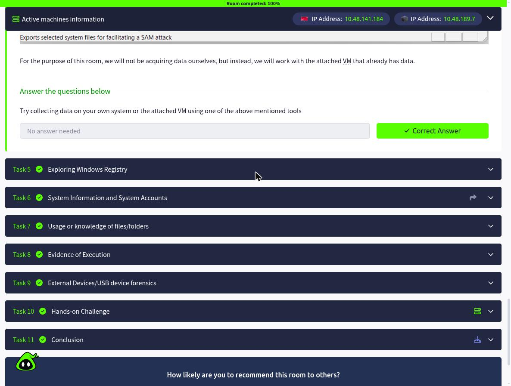
*Figure 14: Task 4 completed*

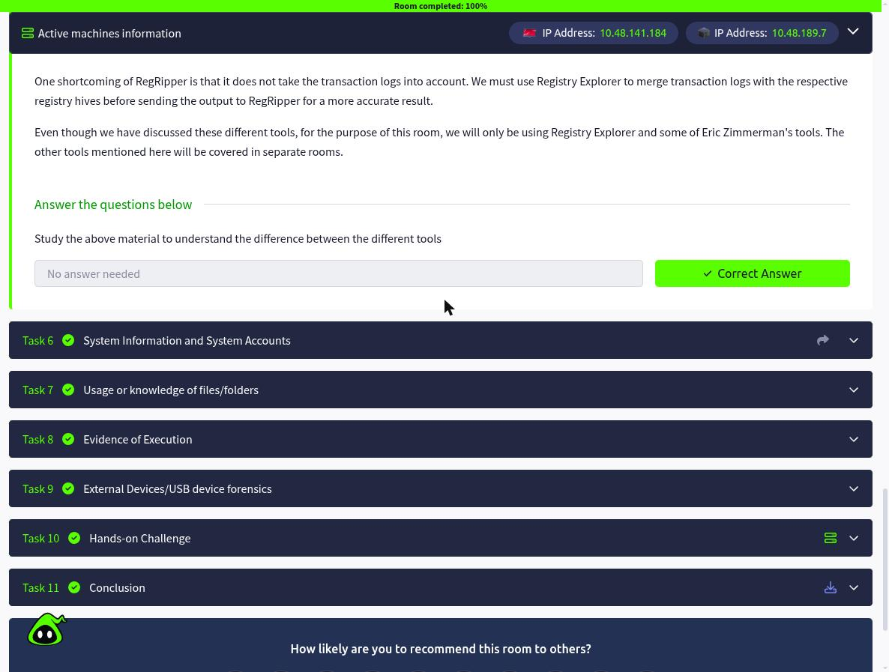
*Figure 15: Task 5 completed*

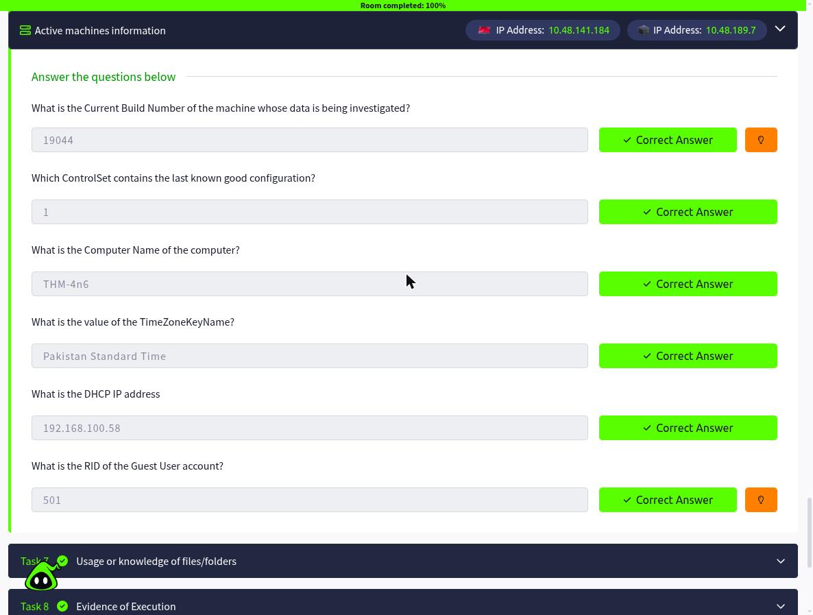
*Figure 16: Task 6 answers (system information and accounts)*

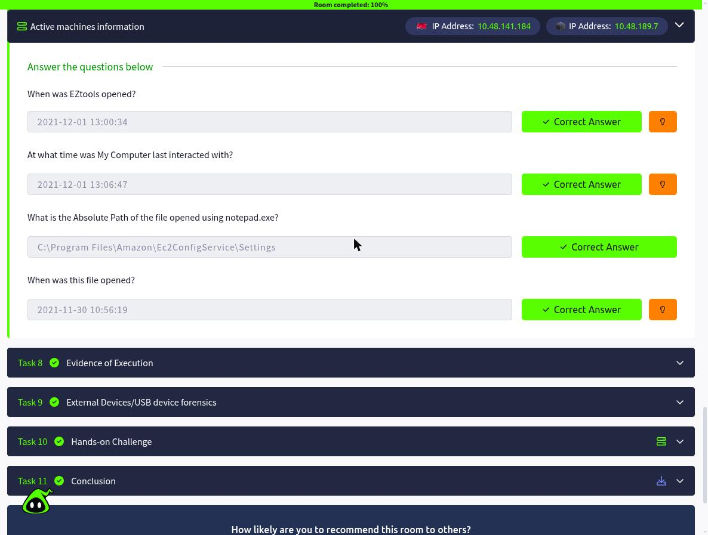
*Figure 17: Task 7 answers (files and folders)*

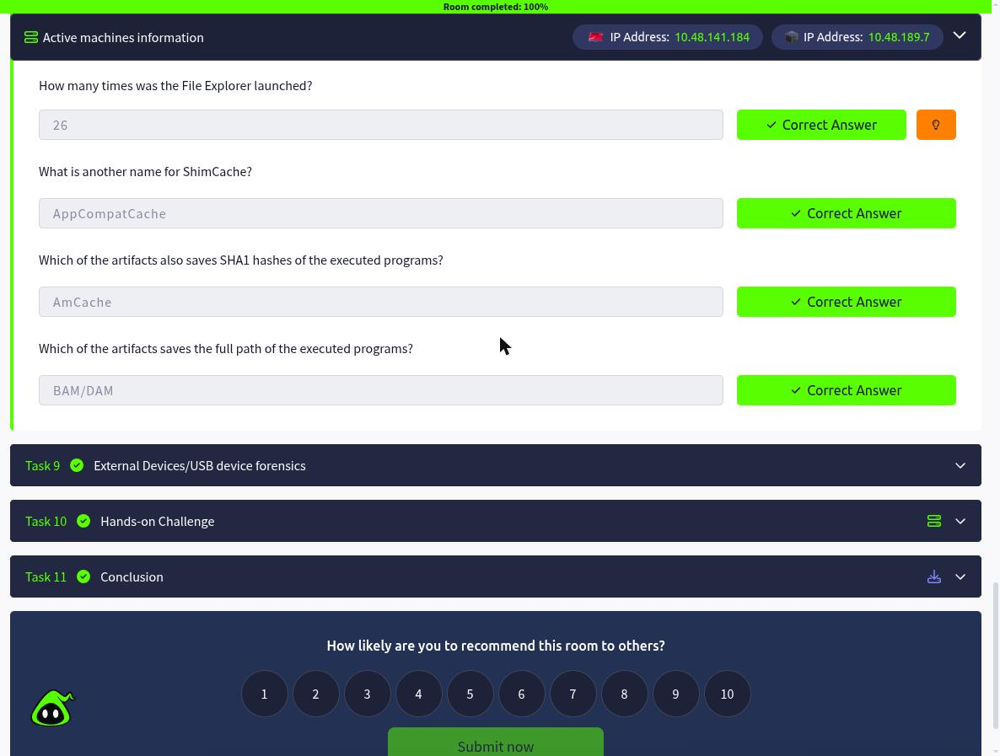
*Figure 18: Task 8 answers (evidence of execution)*

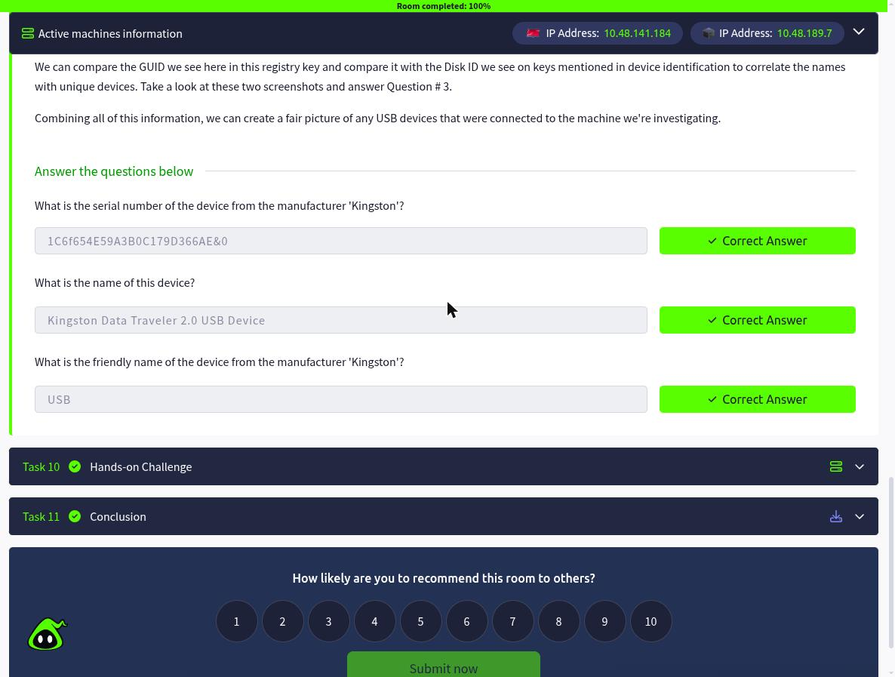
*Figure 19: Task 9 answers (USB device forensics)*

## B5. Hands-on Challenge (Task 10)

**Scenario:** a desktop at Organization X was suspected to have been accessed by someone unauthorized. There were several user accounts on it, it may have been connected to a network drive, and a USB device was plugged in. The triage data was collected with KAPE and put on the VM.

### Setting up

I started the attached Windows VM and opened the EZtools folder on the desktop, then launched RegistryExplorer.exe from the RegistryExplorer folder. The triage collection is in Desktop\triage\C, which follows the same folder layout as a normal C drive.

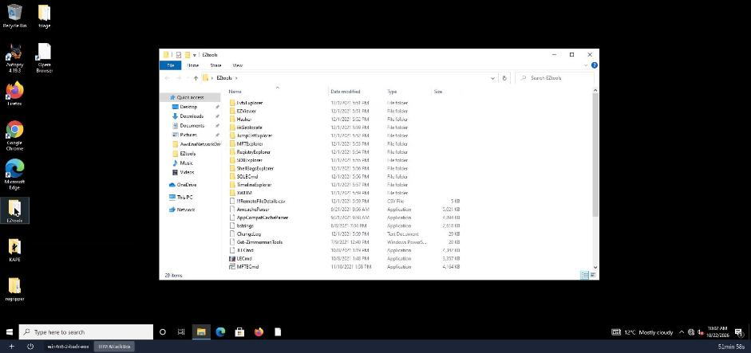
*Figure 20: EZtools folder on the lab VM*

I loaded three hives with File > Load hive: SAM and SYSTEM from triage\C\Windows\System32\config, and NTUSER.DAT from triage\C\Users\THM-4n6. Registry Explorer warned that the NTUSER.DAT and SYSTEM hives were dirty because the transaction logs had not been merged. I chose to load them anyway since the data I needed was already there.

### User accounts (SAM hive)

Using the Users bookmark (SAM\Domains\Account\Users), Registry Explorer shows all accounts in a table. The built-in accounts have RIDs 500 to 504. The user created accounts start from RID 1000, and there are three of them: THM-4n6 (1001), thm-user (1002) and thm-user2 (1003). thm-user2 has a total login count of 0 and no last login time, so it has never been logged in. The Password Hint column for THM-4n6 shows "count".

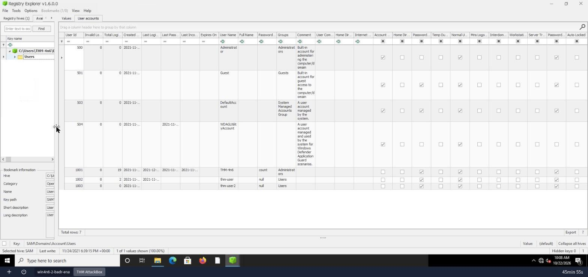
*Figure 21: User accounts from the SAM hive in Registry Explorer*

### Changelog.txt access time (NTUSER.DAT)

The RecentDocs key (Software\Microsoft\Windows\CurrentVersion\Explorer\RecentDocs) keeps a list of recently opened files. Under the .txt extension, ChangeLog.txt is listed with an opened time of 2021-11-24 18:18:48.

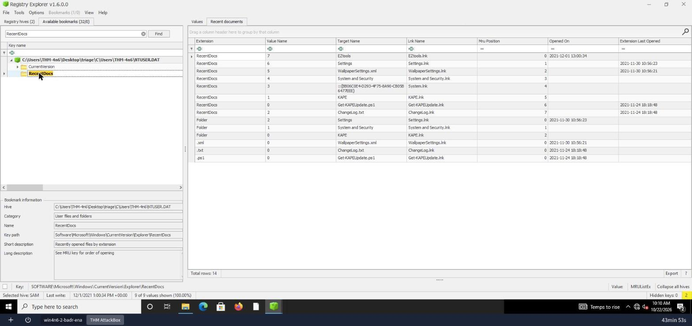
*Figure 22: RecentDocs showing ChangeLog.txt*

### Python installer path (NTUSER.DAT)

I first checked BAM in the SYSTEM hive, but the python installer was not listed for the user SIDs there. I then opened UserAssist under Software\Microsoft\Windows\CurrentVersion\Explorer\UserAssist\{CEBFF5CD-ACE2-4F4F-9178-9926F41749EA}\Count, which tracks programs started from Explorer. Registry Explorer decodes the ROT13 names, and the entry Z:\setups\python-3.8.2.exe was found with a last executed time of 2021-11-25 03:32:00. The Z: drive also shows that the system was connected to a network drive, which matches the scenario.

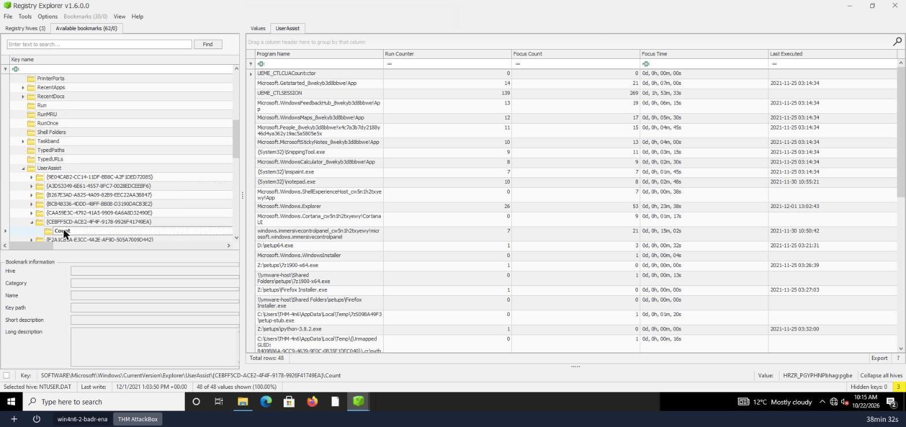
*Figure 23: UserAssist showing the python 3.8.2 installer run from Z:\setups*

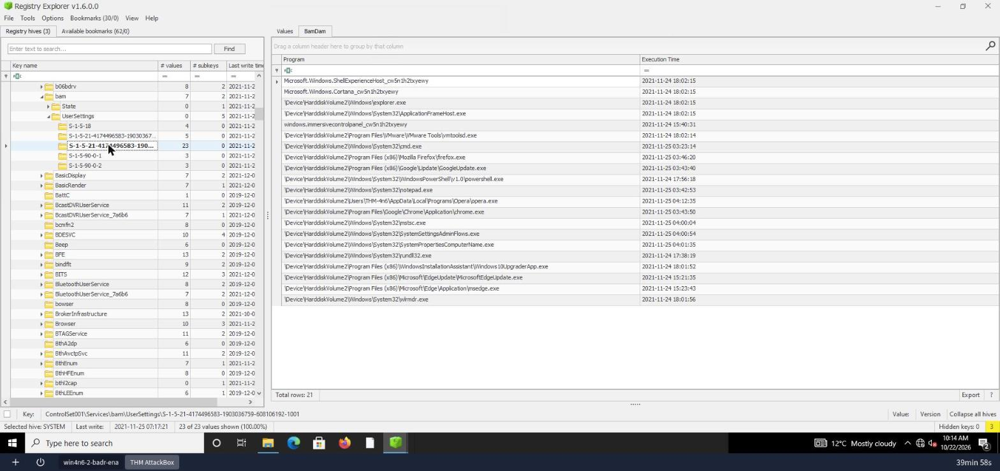
*Figure 24: BAM entries for user RID 1001 (checked first)*

### USB device (SYSTEM hive)

The USBSTOR bookmark (ControlSet001\Enum\USBSTOR) lists two devices. The Kingston DataTraveler 2.0, which has the friendly name "USB" from Task 9, was first installed on 2021-11-24 18:25:15 and last connected on 2021-11-24 18:40:06.

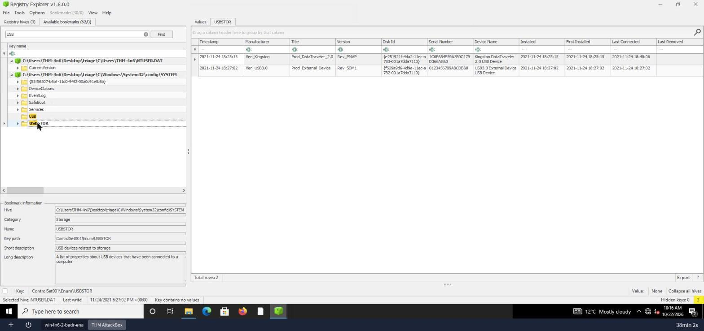
*Figure 25: USBSTOR entries showing the Kingston device*

### Task 10 answers

| No. | Question | Answer |
|---|---|---|
| 1 | How many user created accounts are present on the system? | 3 |
| 2 | Username of the account that has never been logged in? | thm-user2 |
| 3 | Password hint for the user THM-4n6? | count |
| 4 | When was the file Changelog.txt accessed? | 2021-11-24 18:18:48 |
| 5 | Complete path from where the python 3.8.2 installer was run? | Z:\setups\python-3.8.2.exe |
| 6 | When was the USB device with friendly name USB last connected? | 2021-11-24 18:40:06 |

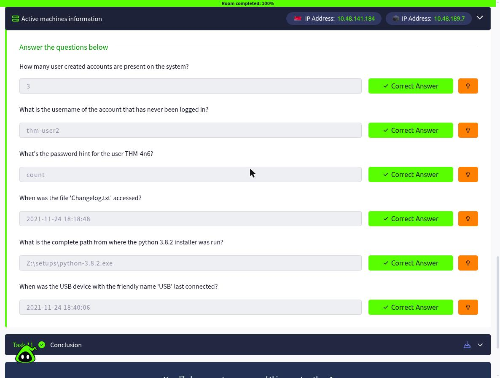
*Figure 26: Task 10 answers accepted*

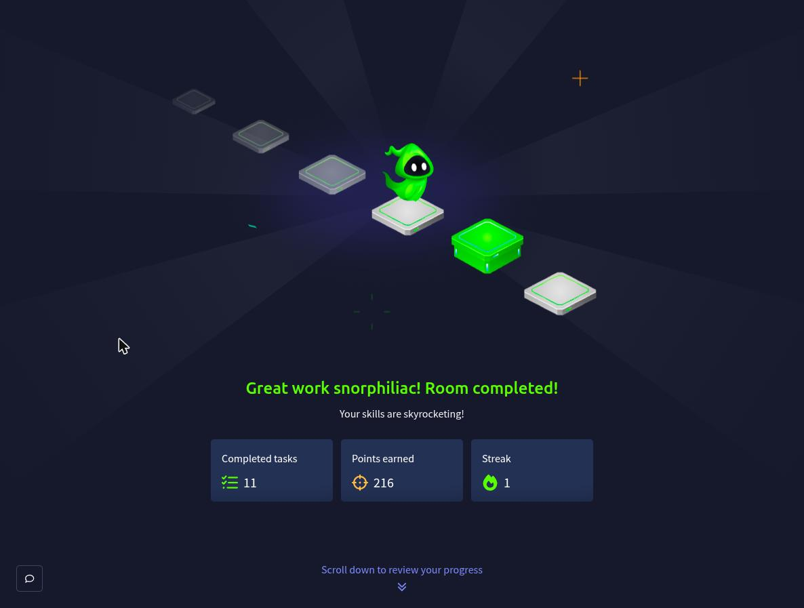
*Figure 27: Room completed (11 of 11 tasks)*

## B6. Conclusion

This room showed that the registry holds a lot of evidence about what happened on a Windows machine. From only three hives in a triage collection I was able to find the user accounts and which one was never used, the password hint of the main user, when a text file was opened, a program run from a network drive and when a USB stick was last plugged in. I also learned that different keys give different details. For example BAM did not have the python installer for this user, but UserAssist did, so it is better to check more than one artifact. Registry Explorer made this much easier than regedit because of its bookmarks and because it decodes values like UserAssist automatically.

---

# Overall Conclusion

The two rooms look at different stages of an investigation. Phishing Analysis Fundamentals is about the first point of contact, where an attacker tries to get in through email, and showed me how to read raw headers and decode attachments to find out who really sent a message. Windows Forensics 1 is about what happens on the machine afterwards, and showed me how the registry records accounts, opened files, executed programs and connected USB devices. In both rooms the main lesson was the same: what is shown on the surface (a display name, a desktop) can be misleading, and the real evidence is in the raw data underneath, whether that is email headers or registry hives.